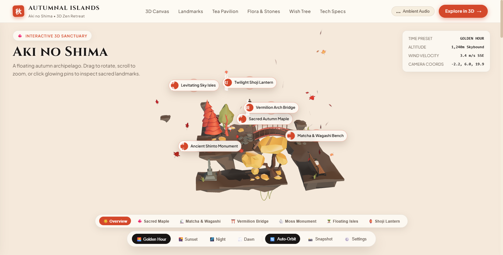
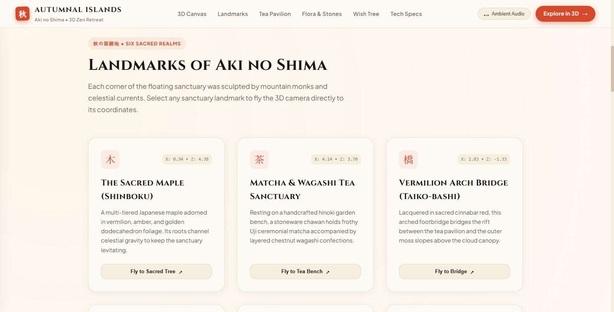
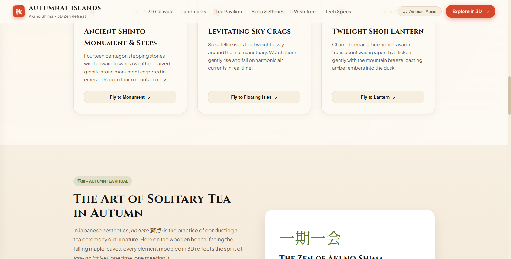
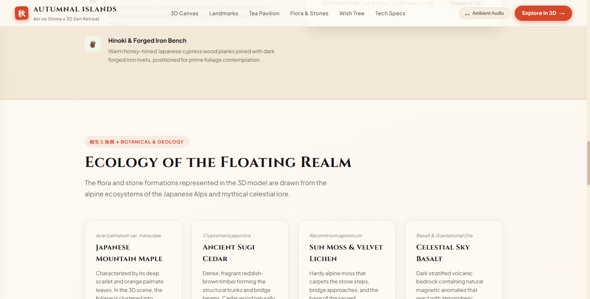

# 🍁 Autumnal Islands (秋の島) — 3D Zen Retreat

<div align="center">

[](https://threejs.org/)
[](https://www.khronos.org/webgl/)
[](LICENSE)

An immersive 3D Japanese autumn sanctuary and floating archipelago with interactive landmark exploration, procedural Zen soundscapes, and day-night cycles built with Three.js.

<br/>



</div>

---

## 📸 Previews

| Interactive 3D Sanctuary | Sacred Landmarks Tour |
| :---: | :---: |
|  |  |
| **Aki No Shima Archipelago** | **Floating Isles & Shrine Pins** |

| Tea Pavilion & Garden | Zen Architecture Specs |
| :---: | :---: |
|  |  |
| **Matcha & Wagashi Rest Area** | **glTF 2.0 PBR Performance Specs** |

---

## ✨ Features

- 🍁 **Interactive 3D Archipelago**: Freely orbit, zoom, and inspect low-poly floating islands in real-time.
- 📍 **Clickable Sacred Landmarks**: Fly the camera directly to landmarks like the Sacred Autumn Maple, Vermilion Arch Bridge, and Shoji Lanterns.
- 🌅 **Atmospheric Lighting Presets**: Switch smoothly between Golden Hour, Sunset, Night, and Dawn lighting.
- 🎶 **Ambient Audio Engine**: Procedural autumn wind, rustling maple leaves, and calming Zen chimes.
- 📸 **Built-In Snapshot Mode**: Capture high-resolution wallpaper screenshots directly from the 3D viewport.
- ⚡ **Zero Setup**: Pre-built static bundle runs out of the box with zero build dependencies.

---

## 🎮 Controls

| Action | Control |
| :--- | :--- |
| **Orbit Camera** | Left-click and drag across the 3D viewport |
| **Zoom View** | Mouse wheel or trackpad scroll |
| **Pan Camera** | Right-click and drag |
| **Inspect Landmark** | Click any glowing red pin or bottom landmark pill |
| **Change Lighting** | Click **Golden Hour**, **Sunset**, **Night**, or **Dawn** |
| **Toggle Ambient Audio** | Click the **Ambient Audio** button in the header |

---

## 🚀 How to Run

1. **Option A (Instant)**: Open `index.html` in your web browser.
2. **Option B (Recommended Server)**:
   ```bash
   python -m http.server 8000
   ```
   Then navigate to [`http://localhost:8000`](http://localhost:8000).

---

## 📄 License

MIT License © 2026 [Sooraj Studio](https://github.com/soorajstudio)
